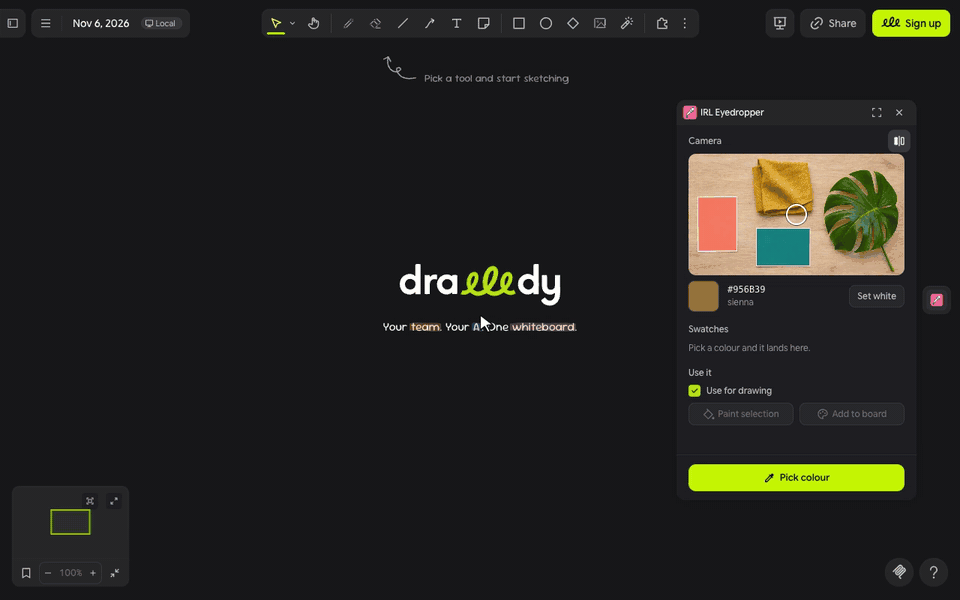

# IRL Eyedropper (⊙_◎)

**pick colours from real life.**

IRL Eyedropper turns your webcam into an eyedropper: hold up a leaf, a scrap of fabric or a paint chip, tap it in the preview and that colour is your pen. Your picks pile up as swatches you can paint shapes with or drop on the board as a labelled palette ✧

---

## let's pick ٩(◕‿◕)۶

1. Click the **drop** in the extension rail. The first time, Drawdy and then your browser ask to use the camera; click Allow on both.
2. Hold the thing you love up to the camera and tap it in the preview, or put it under the ring and press **Pick colour** (Space or Enter work too).
3. The colour becomes your pen and shape stroke colour and lands in **Swatches**. Click any swatch to draw with it again.
4. Select shapes, text or lines and press **Paint selection**, or press **Add to board** to drop your swatches as a palette with their hex codes and colour names.

> (・_・;) **colours look off?** Lamps and screens tint the picture. Hold a sheet of white paper under the ring in good light and press **Set white**, then pick again.

---

## make it yours (｡•̀ᴗ-)✧

- **Set white**: corrects the camera's colour cast for the rest of the session; **Reset** undoes it.
- **Use for drawing**: on by default. Turn it off to collect swatches without changing your pen.
- **Mirror**: on by default, like a selfie camera. The ring follows whatever it was on.
- **Swatches**: your last 16 picks, newest first. A colour close to one you already have moves that swatch to the front instead of adding a twin.

---

## little things to try (っ˘ω˘ς )

- Pick the greens of a houseplant and paint a whole mind map with them.
- Build a moodboard palette from your sofa, your rug and your favourite mug.
- Match a brand colour from a printed card or a product box before you sketch.
- Sample paint chips at the hardware store, then try them on a floor plan.

---

**the small print**: the panel loads its font from jsDelivr and fetches nothing else. Drawdy runs the camera only while the panel is open, and the video never leaves your browser: colours are read from the picture right in the panel. Your swatches and the **Use for drawing** choice are saved in Drawdy's extension storage. Code [MIT](https://github.com/mickyngub/drawdy-irl-eyedropper/blob/main/LICENSE); building it yourself? See [DEVELOPMENT.md](https://github.com/mickyngub/drawdy-irl-eyedropper/blob/main/DEVELOPMENT.md).
